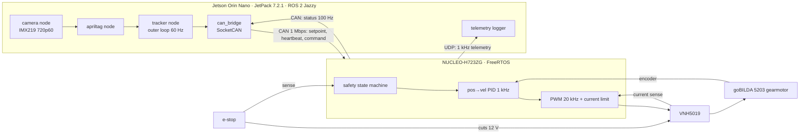

# Jetson Orin + STM32H7 closed-loop visual tracker

> Status: in progress (started October 2026).

A camera mounted to a motor for visually tracking and centering an AprilTag (pan-only).

Vision in ROS 2 runs on a **Jetson Orin Nano**, while an **STM32H723** controls a geared DC motor in a 1 kHz closed loop. The real-time MCU communicates with the Jetson via **CAN**, with bulk telemetry handled over **Ethernet**. The motor control loop runs independently of the Linux and ROS 2 timing on the Jetson, and disables the motor if the jetson stops responding.

Safety:
- hardware e-stop
- firmware state machine
- heartbeat timeout
- current limiting
- watchdog timer

## Demo
Coming soon

## Results
| Metric | Target (Day 0 estimate) | Measured |
|---|---|---|
| Photon-to-motion latency, p50 / p90 | < 60 / 80 ms | TBD |
| Control-loop period jitter, p99 | < 2 µs | TBD |
| Step response (30°): rise time / overshoot | < 100 ms / < 10 % | TBD |
| Heartbeat-loss → motor disabled | ≤ 50 ms | TBD |

## Architecture (planned)


## Repo layout (planned)
```
firmware/   STM32 firmware: lib/ (portable, host-tested), bsp/ (CubeMX), app/
ros2_ws/    ROS 2 packages (camera, apriltag, tracker, can_bridge)
hardware/   BOM, wiring
docs/       plan, setup guides, design, CAN spec, results
tools/      analysis scripts (jitter, step response, latency)
```
