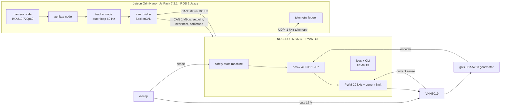

# Jetson Orin + STM32H7 closed-loop visual tracker

> Status: in progress (started October 2026).

A camera mounted to a motor for visually tracking and centering an AprilTag (pan-only).

Vision in ROS 2 runs on a **Jetson Orin Nano**, while an **STM32H723** controls a geared DC motor in a 1 kHz closed loop. The real-time MCU communicates with the Jetson via **CAN**, with bulk telemetry handled over **Ethernet**. The motor control loop runs independently of the Linux and ROS 2 timing on the Jetson, and disables the motor if the Jetson stops responding.

Safety:
- hardware e-stop
- firmware state machine
- heartbeat timeout
- current limiting
- watchdog timer

## Progress
- [x] Jetson: JetPack 7.2.1 + ROS 2 Jazzy, IMX219 at 720p60 (59.77 fps, 0 dropped over ~68 s)
- [x] PID controller with host unit tests (anti-windup, no derivative kick, NaN-safe config)
- [x] STM32 bring-up: 520 MHz, FreeRTOS, task table, queued leveled logging, UART CLI
- [x] STM32 task framework: pub/sub messaging, startup sync, supervisor skeleton, LED task
- [ ] 1 kHz control tick + jitter measurement
- [ ] CAN link to the Jetson
- [ ] Motor, encoder, current sense
- [ ] Safety: e-stop, heartbeat, watchdog
- [ ] ROS 2 tracking pipeline
- [ ] Measured results

## Demo
Coming soon

## Results
| Metric | Target (Day 0 estimate) | Measured |
|---|---|---|
| Photon-to-motion latency, p50 / p90 | < 60 / 80 ms | TBD |
| Control-loop period jitter, p99 | < 2 µs | TBD |
| Step response (30°): rise time / overshoot | < 100 ms / < 10 % | TBD |
| Heartbeat-loss → motor disabled | ≤ 50 ms | TBD |

## Architecture (planned)


## Repo layout
```
firmware/
  lib/        portable C, host-tested (PID, CLI parser, LED fade)
  tests/      Unity host tests
  nucleo/     NUCLEO-H723ZG target: CubeMX BSP (Core/, Drivers/, .ioc) + app/
  scripts/    build.sh, test.sh (host), build_nucleo.sh, flash.sh (target)
ros2_ws/      ROS 2 packages (camera, apriltag, tracker, can_bridge)
hardware/     BOM, wiring
docs/         plan, worklog, firmware architecture, results/
tools/        analysis scripts (jitter, step response, latency)
```

## Build and test
Needs cmake, ninja, Arm GNU Toolchain (`arm-none-eabi-gcc`), and STM32CubeProgrammer (`STM32_Programmer_CLI` on PATH).

```
./firmware/scripts/test.sh            # host unit tests (PID, CLI, LED fade)
./firmware/scripts/flash.sh           # build + flash the Nucleo over ST-LINK
screen /dev/cu.usbmodem* 115200       # logs + CLI, type ? for commands
```

### Debugging in VS Code
Open the repo folder and install the recommended extensions when prompted (`.vscode/extensions.json`): Cortex-Debug, RTOS Views, STM32Cube for VS Code (provides the ST-LINK GDB server, STM32CubeProgrammer, and the STM32H7 device pack), CMake Tools.

| Key | Does |
|---|---|
| `Cmd + Shift + B` | Build the Nucleo firmware (`.vscode/tasks.json`) |
| `F5` | Build, flash, debug, stop at `main()` (`.vscode/launch.json`, "Debug nucleo") |

"Attach nucleo" connects to a running board without reflashing or resetting, for looking at a hang or fault.

Tool versions the debug config expects: ST-LINK GDB server 7.14.0, STM32CubeProgrammer 2.23.0, STM32H7xx DFP 1.3.0 (paths under `~/Library/Application Support/stm32cube/`). If an extension update changes them, find the new paths with `mdfind -name ST-LINK_gdbserver` (and `STM32_Programmer_CLI`, `STM32H723.svd`) and update `launch.json`.

Optional shortcuts, in your own keybindings (`Cmd + Shift + P` → Preferences: Open Keyboard Shortcuts (JSON)):
```json
{ "key": "f6",          "command": "workbench.action.tasks.runTask", "args": "flash nucleo" },
{ "key": "cmd+shift+t", "command": "workbench.action.tasks.runTask", "args": "host tests" }
```
`F6` replaces VS Code's "Focus Next Part" and `Cmd + Shift + T` replaces "Reopen Closed Editor".

## Docs
- [Plan](docs/plan.md): milestones, results targets, scope
- [Worklog](docs/worklog.md): day-by-day progress
- [Firmware architecture](docs/firmware-architecture.md): tasks, priorities, logging, memory
- [Results](docs/results/): raw measurements
